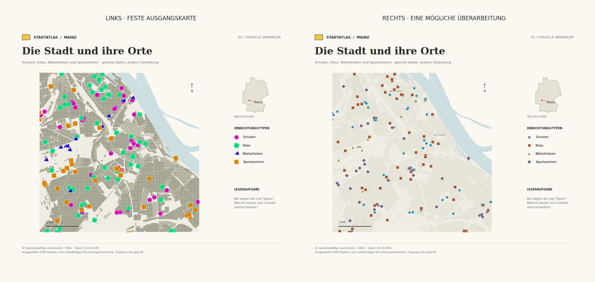

# Kartographie · Hochschule Mainz

Interaktive Übungen für Digitale Kartographie, Prof. Dr.-Ing. Yu Feng.
Interaktive Webübungen mit offenen Bibliotheken. Ohne Anmeldung, Installation oder kostenpflichtige Karten-API.

| Übung | Thema | Stand |
|---|---|---|
| [01](01_visual_variables_color/) | Kartendesigns beurteilen und verbessern · Mainz | Zwei interaktive Webseiten, ca. 45 Minuten |
| [02](02_map_generalization/) | Map Generalization / Kartengeneralisierung | Ordner vorbereitet |
| [03](03_map_projection/) | Map Projection / Kartenprojektionen | Ordner vorbereitet |
| [04](04_3d_geovisualization/) | 3D-Geovisualisierung | Ordner vorbereitet |

## Übung 01 im Browser starten

- [Teil 1 · Bertins visuelle Variablen](https://yfeng-hsm.github.io/Karto_HS_Mainz/docs/bertin.html)
- [Teil 2 · Farben und Klassifikation](https://yfeng-hsm.github.io/Karto_HS_Mainz/docs/farben.html)

Ca. 45 Minuten: oben den Auftrag lesen, links die problematische Karte diskutieren, rechts verbessern. Jede Einstellung aktualisiert die rechte Karte sofort. Die Ausgangskarte bleibt unverändert. SVG und PNG können exportiert werden. Beide Karten enthalten einen Deutschland-Locator mit Mainz. Auf Laptops bleiben Bedienelemente und beide Karten gemeinsam im sichtbaren Fenster; Aufgaben und Datenhinweise sind ausklappbar.

Alle Karten werden lokal im Browser aus mitgelieferten Daten gezeichnet. Es werden keine externen Karten-APIs benötigt. D3 7.9.0 ist inklusive MIT-Lizenz im Repository enthalten.

### GitHub Pages aktivieren

Settings → Pages → Deploy from a branch → **main**, Ordner **/docs** → Save.
Die Website-Dateien liegen in [docs](docs/). Lokal: `python -m http.server 8000 --directory docs`.

Das frühere [Colab-Notebook](01_visual_variables_color/01_Visuelle_Variablen_und_Farbe.ipynb) bleibt als optionale Python-Version erhalten.

## Lizenzen und Quellen

Code: [MIT](LICENSE). Daten separat: © OpenStreetMap contributors (ODbL) und © Statistische Ämter des Bundes und der Länder, 2024, Zensus 2022 (DL-DE/BY-2.0). Siehe [Datenhinweise](01_visual_variables_color/data/). Bevölkerungsstichtag: 15.05.2022. OSM-Stand: 24.10.2026. Keine aktuellen amtlichen Einwohner- oder Einrichtungsverzeichnisse.

## Entwicklung

`python tools/build_notebook.py` aktualisiert den eingebetteten Code und die Daten nach Änderungen. `python tools/check_lab.py` prüft die Klassifikation, die Ausgangsentwürfe und die Widget-Aktionen ohne Colab-Anmeldung. Ein tatsächlicher angemeldeter Colab-Browserlauf ist zusätzlich zu prüfen.

## Vorschau: von der Diagnose zum Redesign

Die rechte Karte ist ein Gestaltungsbeispiel, keine einzig gültige Lösung. Im Notebook bleibt der linke Ausgangsentwurf unverändert; Studierende überarbeiten die rechte Karte.
